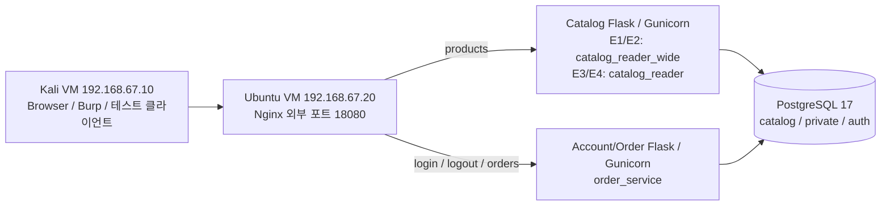

# 아키텍처와 권한 경계

## 네트워크

| 네트워크 | 연결 서비스 | 외부 경로 |
|---|---|---|
| `edge` | Nginx만 | Ubuntu Host-only 주소의 HTTP 포트 하나만 publish |
| `web`, internal | Nginx, Catalog, Orders | 앱 포트 publish 없음 |
| `database`, internal | PostgreSQL, Catalog, Orders | DB 포트 publish 없음 |

일시 테스트 컨테이너만 검증 프로필에서 web/database에 추가됩니다. Docker 소켓은 마운트하지 않습니다.
Nginx에는 DB 자격증명이 없고, Catalog에는 선택한 reader 역할 하나의 자격증명만 전달합니다.
E1/E2는 `catalog_reader_wide`, E3/E4는 `catalog_reader`를 사용하며 주문·관리 계정은 전달하지 않습니다.
앱·Nginx는 비root, 루트 파일시스템 읽기 전용, `/tmp` tmpfs, capability 제거로 실행합니다.
PostgreSQL은 공식 이미지의 entrypoint를 통해 데이터 디렉터리를 준비하고 postgres OS 사용자로 실행합니다.

Nginx는 edge 네트워크를 통해 호스트 HTTP 포트를 공개합니다. DB와 앱은 내부 네트워크를 사용합니다.
VMnet1 자체의 DHCP·호스트 네트워크 설정은 유지했습니다. 두 VM에 두 번째 Host-only NIC를 추가했고,
Ubuntu 기존 NAT와 기존 5000번 웹서비스는 보존했습니다. Kali NAT 연결은 비활성화해 기본 외부 경로가 없습니다.

| 실제 VM | 인터페이스 | 주소 | 용도 |
|---|---|---|---|
| Ubuntu Server | ens37 | 192.168.67.20/24 | MiniShop HTTP·검증용 Host-only |
| Ubuntu Server | ens33 | 192.168.186.128/24 | 기존 NAT 관리·다운로드, 기존 서비스 유지 |
| Kali | eth1 | 192.168.67.10/24 | Ubuntu 대상 요청·Burp·공격 실험 |
| Kali | eth0 | 연결 해제 | 기존 NAT 프로필 보존, 자동 연결 비활성화 |

## DB 초기화

1. `create_env.py`: 무작위 DB·웹 비밀번호와 PBKDF2-SHA256 1,000,000회 해시 생성. 기존 파일은 유지.
2. 공식 PostgreSQL entrypoint가 빈 볼륨에서 `00-bootstrap.sh` 실행.
3. psql `\getenv`로 비밀값을 읽고, 한 트랜잭션에서 역할·테이블·시드·GRANT/REVOKE 구성.
4. DB healthcheck가 시드 테이블 조회까지 성공해야 앱을 시작.
5. 앱 healthcheck 성공 뒤 Nginx 시작. Nginx는 Docker DNS를 다시 조회해 앱 재생성에 대응.

테이블과 뷰의 소유자는 `minishop_owner`(NOLOGIN)입니다. 앱 역할은 소유자·상속 멤버가 아닙니다.
PUBLIC의 DB CONNECT/CREATE/TEMP와 사용자 스키마 권한을 회수하고 필요한 CONNECT·USAGE·SELECT만 부여합니다.
새 사용자 객체의 기본 PUBLIC 테이블·시퀀스·함수 권한도 회수합니다.
이 설정은 이 프로젝트 전용의 새 PostgreSQL 컨테이너에만 적용합니다.

## 데이터와 권한

- `catalog.products`: 공개 12개 + 비공개 1개. 제한된 SELECT 정책은 공개 행만 반환.
- `catalog.public_products`: 공개 뷰, `security_barrier=true`, `WHERE is_public`.
- `auth.users`: 합성 사용자 100명, user1/user2만 로그인 가능.
- `private.customers`: 고객 100명. PII는 `example.invalid`, TEST-PHONE, Synthetic Zone 형태.
- `private.orders`: 고객당 3개, 총 300개. user1 주문 1001~1003, user2 주문 2001~2003.
- `private.payment_meta`: 주문당 1개, 총 300개. TEST_CARD/TEST_WALLET와 가상 참조값만 저장.
- `auth.sessions`: 임의 쿠키 토큰 해시·CSRF 해시·user_id·만료시각.

`order_service`의 고객 테이블 접근은 `(id,user_id)` 열로 제한합니다.
주문 API가 사용하지 않는 고객 이름·이메일·전화·주소와 결제 메타에는 권한을 주지 않았습니다.
반면 서버 세션 유지에 필요한 `auth.sessions` SELECT/INSERT/DELETE는 부여합니다.
일반 서비스에는 CREATE/ALTER/DROP 권한, 광범위 DB 역할, 서버 파일 접근 권한을 부여하지 않습니다.

DB 역할과 웹 사용자의 권한 경계는 다릅니다. 주문 조회는 같은 `order_service` 역할을 사용하므로
`JOIN private.customers ... WHERE c.user_id = %s` 조건을 목록과 상세에 모두 적용합니다.
타인 주문과 존재하지 않는 주문 모두 같은 404 본문을 반환합니다.

## 인증·감사

인증은 실제 저장된 비밀번호 해시 검증 후에만 세션을 만듭니다. 미존재 사용자도 같은 해시 비용의 검증을 거칩니다.
로그인 JSON만 허용하고 Origin이 있으면 동일 출처를 확인합니다. 로그아웃은 세션별 CSRF 토큰을 검사합니다.
쿠키 원문은 DB에 저장하지 않으며, 로그아웃 시 DB 세션을 제거해 복사된 쿠키도 거부합니다.

Nginx가 외부 X-Request-ID를 덮어쓰고 동일 ID를 앱과 응답에 전달합니다.
앱 로그는 요청 메서드·라우트 템플릿·숫자 user_id·DB 역할·HTTP 상태·인가결과·처리시간을 남깁니다.
SQL 로그는 코드 소유 템플릿·템플릿 ID·파라미터 수와 타입을 기록하고 **모든 파라미터 값은 마스킹**합니다.
E1/E3의 검색만 문자열을 직접 삽입하며 `binding=interpolated`로 기록합니다. 삽입 후 SQL 원문은 기록하지 않습니다.
다른 쿼리는 항상 인자를 바인딩하고, 취약 검색은 Catalog의 명시적 실험 설정에서만 활성화됩니다.
일반 요청 본문, 검색어, 원문 비밀번호·토큰·고객 PII, 예외의 DSN 문자열은 기록하지 않습니다.
PostgreSQL에도 오류 SQL 원문의 자동 기록을 끄는 설정을 적용했습니다.

감사 로그 수집을 지원합니다. 자동 탐지 규칙·alert 저장소는 미구현이며 탐지율·오탐률은 N/A입니다.

## 기술 근거

- [PostgreSQL GRANT](https://www.postgresql.org/docs/17/sql-grant.html): DB·스키마·테이블·열 권한 구별.
- [PostgreSQL CREATE VIEW](https://www.postgresql.org/docs/17/sql-createview.html): 뷰 소유자 권한과 security_barrier.
- [Psycopg 파라미터 전달](https://www.psycopg.org/psycopg3/docs/basic/params.html): SQL 템플릿과 값의 별도 전달.
- [Docker Compose 시작 순서](https://docs.docker.com/compose/how-tos/startup-order/): 단순 실행과 service_healthy 구별.
- [Flask 보안 고려사항](https://flask.palletsprojects.com/en/stable/web-security/): CSRF·요청 크기·쿠키 설정.
